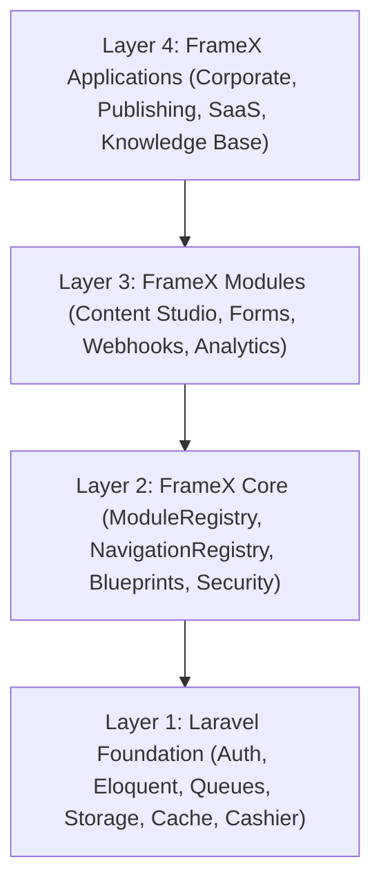

# FrameX Platform Architecture & Developer Guide

> **Tagline:** Build More. Start Less.  
> **Core Principle:** FrameX is not a CMS that happens to have Laravel features. It is a complete, modular Laravel application platform whose first-class capability is managing content, extensions, and digital business infrastructure.

---

## 1. Architectural Philosophy: The 4-Layer Modular Monolith

FrameX organizes platform capabilities into four distinct, decoupled layers:



1. **Layer 1: Laravel Foundation**
   - Core framework primitives: database migrations, Eloquent ORM, Fortify authentication, Cashier Stripe billing, queues, events, and caching.
2. **Layer 2: FrameX Core**
   - Platform contracts (`ModuleInterface`, `BlueprintInterface`), registries (`ModuleRegistry`, `NavigationRegistry`, `BlueprintRegistry`), immutable revision engine (`RevisionService`), and permission matrices.
3. **Layer 3: FrameX Modules**
   - Self-contained domain capabilities with dedicated controllers, services, models, routes, and UI studios (`ContentStudio`, `Forms`, `Webhooks`, `Analytics`).
4. **Layer 4: FrameX Applications**
   - Turnkey solution blueprints assembled from core and modules, deployable in seconds via CLI.

---

## 2. Core Modules & Studio Suites

### 2.1 Content Studio (Milestone 2)
- **Block-Based TipTap Studio:** Semantic rich-text editing with headings, callouts, code blocks, images, tables, and block-level metadata.
- **Unified Schema:** Polymorphic `contents` table supporting posts, pages, docs, and custom content types.
- **Immutable Revision Engine:** Every save creates a timestamped revision snapshot, enabling visual diffing and 1-click safe restoration.
- **Editorial Publishing Workflow:** Multi-state machine (`Draft` ➔ `In Review` ➔ `Approved` ➔ `Published` ➔ `Scheduled` ➔ `Archived`) with automated scheduled publishing worker (`php artisan framex:publish-scheduled`).
- **Media Studio:** Centralized asset management with drag-and-drop uploads, folder hierarchies, and usage tracking.
- **SEO Studio & Dynamic Sitemap:** Automated Open Graph previews, canonical URLs, and `/sitemap.xml` generation.
- **Headless Content REST APIs:** Bearer token authorized `/api/v1/content` endpoints.

### 2.2 FrameX Administration (Milestone 3)
- **Universal Command Palette (Ctrl+K):** Real-time fuzzy search across all content items, media assets, taxonomies, and team settings.
- **Content Studio Dashboard:** Publication calendars, status breakdowns, and author activity feeds.
- **Data Tables & Bulk Operations:** Batch publish, review, archive, and soft-delete operations.
- **Granular Permission Matrix:** Team-scoped RBAC with customizable roles (Owner, Admin, Editor, Author, Viewer).

### 2.3 Business Infrastructure (Milestone 4)
- **Dynamic Forms Builder:** Visual field composer (text, email, select, textarea) with server-side validation, honeypot spam protection, submission viewer, and CSV export.
- **Outbound Webhooks Engine:** Event-driven dispatcher signing payloads with HMAC-SHA256 (`X-FrameX-Signature`) and delivery audit logging.
- **Privacy-Friendly Analytics:** Daily deduplicated, anonymized IP hash telemetry logging views and referrers.

---

## 3. Extension Ecosystem (Milestone 5)

FrameX allows developers to build and distribute third-party extensions cleanly:
- **Module Generator CLI:**
  ```bash
  php artisan framex:make-module ECommerce --with-ui
  ```
- **Topological Boot Ordering:** Automatically resolves module dependencies and boots them in correct order.
- **Circular Dependency Detection:** Detects circular references before runtime execution.
- **Module Lifecycle CLI:**
  ```bash
  php artisan framex:modules:list
  php artisan framex:module:enable <id>
  php artisan framex:module:disable <id>
  ```

---

## 4. Application Blueprints (Milestone 6)

Pre-built domain blueprints ready to customize:
```bash
php artisan framex:blueprint:list
php artisan framex:blueprint:install corporate
php artisan framex:blueprint:install publishing
php artisan framex:blueprint:install saas
php artisan framex:blueprint:install docs
```

---

## 5. Diagnostics & Showcase (Milestone 7)

- **System Diagnostics Doctor:**
  ```bash
  php artisan framex:doctor
  ```
- **Interactive Demo Showcase Seeder:**
  ```bash
  php artisan framex:demo:seed
  ```
  Access the seeded showcase at `/framex-demo/dashboard` (Email: `demo@framex.dev`, Password: `password123`).
